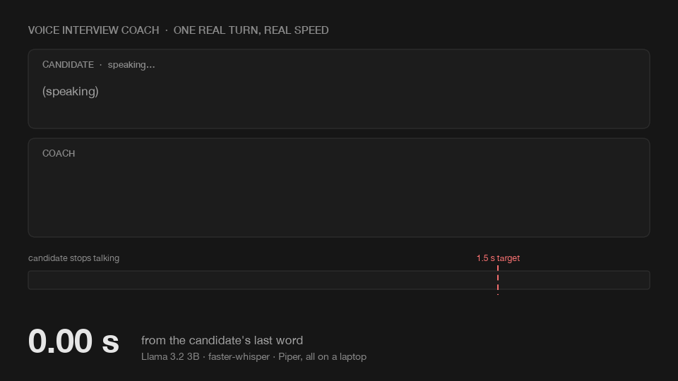
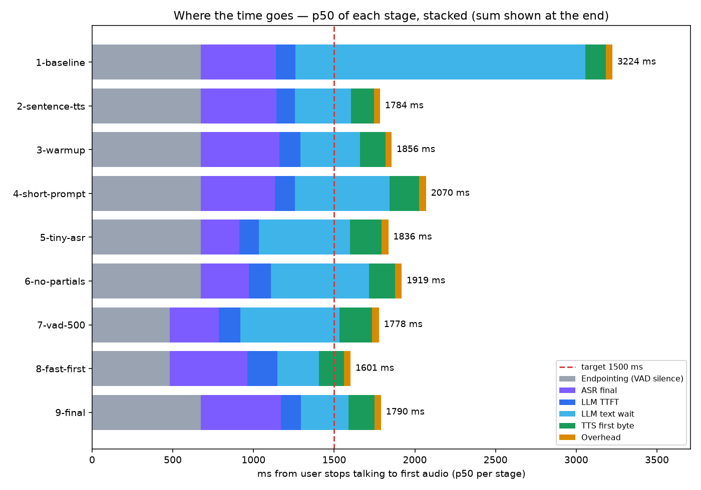
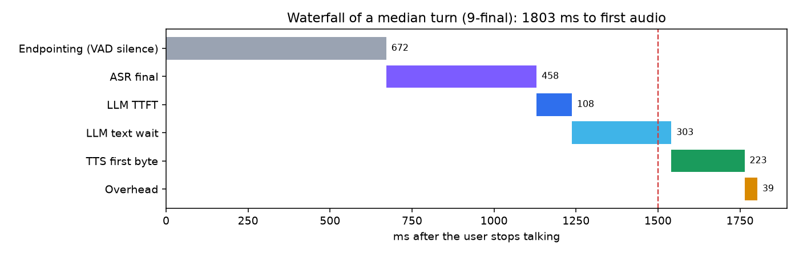

# Real-Time Voice Assistant — Mock Interview Coach

[](https://github.com/krushaalkalkani/realtime-voice-assistant/actions/workflows/tests.yml)
**Live site:** https://voice-interview-coach-mocha.vercel.app (results, architecture, and an interactive replay of recorded sessions)

Speak into the browser → speech-to-text → local LLM → text-to-speech → the coach answers out loud.
Everything runs locally and costs $0. Every pipeline stage emits a timestamped event, so each turn's latency is broken down stage by stage, and every component can fail without freezing the conversation.



*One real benchmark turn, replayed at real speed from its event log: where the 1.8 s between "the candidate stops talking" and "the coach starts talking" goes.*

| Result | |
|---|---|
| Median time to first audio | **1.80 s** (from 3.38 s, −47%) · p95 2.02 s (from 5.65 s) |
| Failure scenarios (ASR / LLM / TTS down, hung, stalled; real outage; barge-in) | **11 / 11 degrade instead of hanging**, all recover on the next turn |
| Deterministic replay of recorded sessions | **30 / 30 turns identical** |
| Tests | 27, run in CI on every push |

**Status:** Phase 1 (end-to-end streaming pipeline) ✅ · Phase 2 (latency budget) ✅ · Phase 3 (resilience) ✅

## Run it

Requires [uv](https://docs.astral.sh/uv/) and [Ollama](https://ollama.com).

```bash
uv sync
ollama pull llama3.2:3b          # main model
ollama pull phi4-mini            # fallback model, used when the main one is slow or down
uv run python -m piper.download_voices en_US-lessac-medium --data-dir models/piper   # one-time, ~60 MB
uv run uvicorn server.main:app --port 8010
```

Open http://localhost:8010, press **Start**, allow the mic, and answer the coach. Pause ~1 s when you finish speaking. (The Whisper model downloads itself on the first run.) Talk over the coach to interrupt it, or type in the box instead. Press **🧪 Faults** to break components on purpose.

Tests and a headless end-to-end check (fakes a browser by streaming generated speech into the WebSocket):

```bash
uv run pytest -q
uv run python scripts/ws_smoke_test.py      # server must be running
```

## How it works

```
Browser mic ─(16 kHz PCM frames over WebSocket)─► server
   VAD (Silero)        detects start / end of the user's speech
   ASR (faster-whisper) turns the utterance into text  (+ rough partials while you talk)
   LLM (Ollama)        streams the coach's reply token by token
   TTS (Piper)         turns the reply into audio, sentence by sentence
Browser speaker ◄─(PCM audio chunks)─┘
Every step ─► typed event ─► logs/sessions/<session>.jsonl  +  live event panel in the page
```

| File | Job |
|---|---|
| `server/main.py` | FastAPI app: serves the page, runs the `/ws` WebSocket |
| `server/pipeline.py` | One `Session` per tab: the VAD → ASR → LLM → TTS turn loop |
| `server/vad.py` | Silero VAD + turn detector (speech start / end) |
| `server/events.py` | Typed, timestamped events → JSONL + browser |
| `server/metrics.py` | Turns event timestamps into a per-turn latency breakdown + p50/p95 |
| `server/chunker.py` | Cuts the LLM token stream into speakable sentences |
| `scripts/benchmark.py`, `scripts/report.py` | Replays the same conversation under each config → tables + charts |
| `dashboard/latency.py` | Streamlit dashboard: p50/p95 per stage, every turn, single-turn waterfall, failures |
| `server/resilience.py` | Time limits for every stage + circuit breaker |
| `server/faults.py` | Fault injection wrappers (down / slow / hang / stall / flaky) + `/faults` endpoint |
| `scripts/fault_injection.py` | Breaks each component against the real models → [docs/fault_results.md](docs/fault_results.md) |
| `replay/replay.py` | Re-runs a recorded session through the pipeline and diffs it against the original |
| `server/{asr,llm,tts}/` | Each engine behind a small interface (`base.py`) so it can be swapped |
| `server/config.py` | All settings; each one can be overridden by an env var |
| `web/` | Page, mic capture (AudioWorklet), audio playback |

Swap a component with env vars, e.g. `LLM_MODEL=phi4-mini ASR_MODEL=tiny.en uv run uvicorn server.main:app --port 8010`.


## Latency budget (Phase 2)

Every turn is split into stages using the event timestamps ([server/metrics.py](server/metrics.py)):

```
user stops   VAD decides   ASR done    LLM 1st token   1st text to TTS   1st audio byte   speaker plays
   |--endpointing--|---ASR---|--LLM TTFT--|--LLM text wait--|--TTS 1st byte--|--overhead--|
```

| Stage | What it is |
|---|---|
| Endpointing | Silence the VAD waits for before deciding you're done (700 ms setting) |
| ASR final | Whisper transcribing the utterance |
| LLM TTFT | Time to the LLM's first token |
| LLM text wait | First token → first text we can speak (whole reply before Phase 2; first sentence/clause now) |
| TTS first byte | Piper producing the first audio |
| Overhead | Gaps between stages, network, browser scheduling |

**Where to see it:** every reply in the web page gets a waterfall bar (red line = 1.5 s target); `uv run streamlit run dashboard/latency.py` shows p50/p95 across all sessions.

### Benchmark method
`scripts/benchmark.py` replays the **same 8 spoken answers** (Piper-generated speech, streamed at real-time pace) into the server under each config, 12 turns per config, cold start each run, fixed LLM sampling seed. Configs are **cumulative**: each one adds a single change, so neighbouring rows isolate one effect. `scripts/report.py` → [docs/latency_results.md](docs/latency_results.md).



| Optimization | Total p50 before | after | Kept? | Why |
|---|---|---|---|---|
| Sentence-level TTS streaming | 3542 ms | 1845 ms | ✅ | Biggest win: speaking starts after sentence 1 instead of the whole reply ("LLM text wait" 2061 → 346 ms) |
| Warm model loading | first turn 3851 ms | first turn 1734 ms | ✅ | Removes the cold start (Ollama loading weights). p50 unchanged, as expected |
| Shorter system prompt | 1972 ms | 2196 ms | ❌ | Made it *slower*: Ollama caches the prompt, so its length barely matters, but the new prompt produced longer first sentences |
| Smaller ASR (tiny.en) | ASR 490 ms | ASR 241 ms | ❌ | 2× faster ASR, but word error rate 3.3% → 6.0% on clean synthetic speech; real voices would be worse. Accuracy matters for a coach |
| No partial ASR while speaking | 1854 ms | 1860 ms | ❌ | No measurable gain, and partials give live on-screen feedback |
| End-of-speech silence 700 → 500 ms | endpointing 672 ms | 480 ms | ❌ | Saves ~190 ms by definition, but cuts people off when they pause to think — can't be validated with synthetic speech |
| First audio chunk ends at a comma | text wait 613 ms | 256 ms | ✅ | The user only waits for the *first* chunk; later chunks are synthesized while earlier audio plays |

Shipped defaults ([server/config.py](server/config.py)): `TTS_MODE=sentence`, `WARMUP=1`, `TTS_FAST_FIRST=1`, base.en ASR, 700 ms endpointing.

### Shipped config vs. Phase 1 (measured back-to-back on an idle machine)

| | Phase 1 baseline | Shipped | Change |
|---|---|---|---|
| **Total to first audio, p50** | 3378 ms | **1801 ms** | **−47%** |
| Total to first audio, p95 | 5654 ms | 2024 ms | −64% |
| First turn (cold start) | 6928 ms | 1871 ms | −73% |
| ASR word error rate | 3.3% | 3.3% | unchanged |

Shipped config, per stage (n=12 turns):

| Stage | p50 (ms) | p95 (ms) |
|---|---|---|
| Endpointing (VAD silence) | 672 | 672 |
| ASR final | 499 | 621 |
| LLM TTFT | 123 | 181 |
| LLM text wait | 296 | 380 |
| TTS first byte | 162 | 234 |
| Overhead | 39 | 46 |
| Pipeline (speech end → audio) | 1129 | 1352 |
| **Total to first audio (user-perceived)** | **1801** | **2024** |



### Did we hit the < 1.5 s target?
**No: 1.80 s p50, ~300 ms over.** The pipeline itself (end of speech detected → first audio) is 1.13 s p50 and 1.35 s p95, which is under the target. What's left is mostly **listening, not thinking**: 672 ms of endpointing silence plus ~500 ms of Whisper on CPU make up about two thirds of the time. The two changes that would close the gap on their own (500 ms endpointing, tiny.en ASR) were measured and rejected because they cut people off or double word errors. The next levers are smarter turn detection (end the turn sooner when the sentence is clearly finished), Whisper on the Apple GPU (`device="mps"`), and streaming ASR.

**Measurement caveats.** n=12 turns per config on a laptop, synthetic (Piper-generated) speech, LLM seed fixed. An earlier run of the shipped config was discarded because macOS background indexing pushed the load average to ~10 and slowed Whisper 2–5×; the numbers above come from a re-run of baseline and shipped config back-to-back on an idle machine (`uv run python scripts/benchmark.py --only 1-baseline 9-final`). Rows 2–8 of [docs/latency_results.md](docs/latency_results.md) come from the earlier cumulative run.

## Resilience (Phase 3)

Every stage has a time limit and a plan B, so a broken component degrades the conversation instead of freezing it. Each failure is logged as a `stage_failed` event (what broke, why, after how long) followed by a `fallback` event (what the assistant did instead), so it shows up in the chat, the event panel, and the dashboard.

| Failure | Detected by | What the user gets |
|---|---|---|
| ASR down / too slow | error, or 3 s + 0.5 s per second of speech | "Sorry, I couldn't make that out… you can type your answer below" — and a text box |
| LLM slow / hung | no first token within 3 s | "Give me a second." spoken right away, then the fallback model (`phi4-mini`) answers |
| LLM and fallback both down | errors | a spoken canned line: "Sorry, I'm having trouble thinking right now…" |
| LLM stalls mid-reply | > 4 s between tokens | the part already generated is kept (it's on screen and spoken) |
| TTS down / hung | error, or 3 s per audio chunk | text-only reply (the text already streams onto the screen) |
| Browser never confirms playback | audio length + 5 s | resume listening anyway |
| User talks over the coach | 400 ms of speech while it's talking | audio stops, the turn is cancelled, the interruption becomes the next turn (**barge-in**) |

- **Circuit breaker:** after a component fails it is skipped for 30 s, so later turns don't each wait for the same timeout; then one trial call checks if it is back.
- **Cold-model awareness** *(found by fault injection)*: on this 16 GB Mac, Ollama keeps only one of the two models in memory, so using the fallback evicts the primary. The next turn then timed out while the primary reloaded, fell back again, and the two models kept evicting each other. Now the server checks `/api/ps` first: if the primary is cold it says "give me a second" immediately and allows 10 s for the reload. Warm-up loads only the primary for the same reason.

**Try it:** press **🧪 Faults** in the page to break ASR / LLM / TTS while you talk, or start with `FAULTS="llm=hang,tts=down"`.

### Fault injection results
`uv run python scripts/fault_injection.py` runs each fault against the real Whisper + Ollama + Piper for one spoken turn, switches it off, and checks the next turn is normal. Full output: [docs/fault_results.md](docs/fault_results.md).

| Fault injected | Behavior | Recovered? |
|---|---|---|
| ASR down | Spoken apology + text box after 0.1 s | ✅ |
| ASR hangs | Timed out at 5.7 s → apology + text box | ✅ |
| LLM down | Filler → fallback model answered; first audio after 0.6 s | ✅ (primary reloads with a filler) |
| LLM hangs | Timed out at 3.0 s → filler → fallback model; audio after 3.5 s | ✅ (primary reloads with a filler) |
| LLM slow (5 s) | Same as a hang: 3 s limit → filler → fallback | ✅ (primary reloads with a filler) |
| LLM stalls mid-reply | Stall detected at 4 s → partial reply kept and spoken | ✅ |
| TTS down | Text-only; reply text on screen after 0.5 s | ✅ |
| TTS hangs | Timed out at 3 s → text-only; text on screen after 0.5 s | ✅ |
| LLM + TTS down | Fallback model, text-only | ✅ (primary reloads with a filler) |
| Barge-in | Coach stopped after 416 ms of user speech; the interruption became the next turn | ✅ |
| Ollama unreachable (real outage, not injected) | Primary + fallback refused in 2 ms → spoken canned line after 0.7 s | n/a (outage persists) |
| **Random faults, 8 turns** | Every turn finished (longest 17 s incl. ~5 s of speech); no hangs | ✅ |

The random run also hit one failure nobody injected: Piper took over 3 s on one turn while Ollama reloaded a model under memory pressure. The TTS timeout caught it, the reply went text-only, and it shows in the metrics like any other failure.

### Replay mode
Every session saves its raw mic audio (`logs/sessions/<id>.wav`) next to its event log; each event carries `audio_pos`, its position in that audio. `replay/replay.py` feeds the recording back through a fresh pipeline and diffs the result turn by turn:

```bash
uv run python replay/replay.py --list
uv run python replay/replay.py <session_id>                              # should be identical
uv run python replay/replay.py <session_id> --set VAD_MIN_SILENCE_MS=400  # would this have cut me off?
uv run python replay/replay.py <session_id> --set ASR_MODEL=tiny.en       # do transcripts change?
uv run python replay/replay.py <session_id> --faults asr=down             # how would it have degraded?
```

To be deterministic, replay runs on a **logical clock** (each turn's work finishes before more audio is fed) and treats everything that came from outside the code as a **recorded input**: the audio, the browser's messages, the faults active on each turn, the LLM replies, failures caused by the environment (Ollama down, a model still loading, TTS starved of CPU), and circuit-breaker decisions (they depend on how long earlier turns took). VAD and Whisper are deterministic, so they run for real. **Result: all 12 fault-injection sessions (30 turns, including the random run, barge-in and the outage) replay identically.**

Getting there took three rounds, and each one exposed an input the recording wasn't capturing yet: faults switched on live, the breaker's notion of time, and environment failures.

## Showcase site
[`site/`](site/) is a static page deployed on Vercel (it can't host the assistant itself: that needs local models and a long-lived WebSocket server). Its data comes from the recorded benchmark and fault-injection sessions; the "user" in those is generated speech, and live sessions are never exported.

```bash
uv run python scripts/export_site_data.py   # sessions + benchmark summary -> site/data/*.json (paths stripped)
uv run python scripts/make_site_media.py    # site/demo.gif + site/og.png from a real recorded turn
python3 -m http.server 8030 --directory site
```

